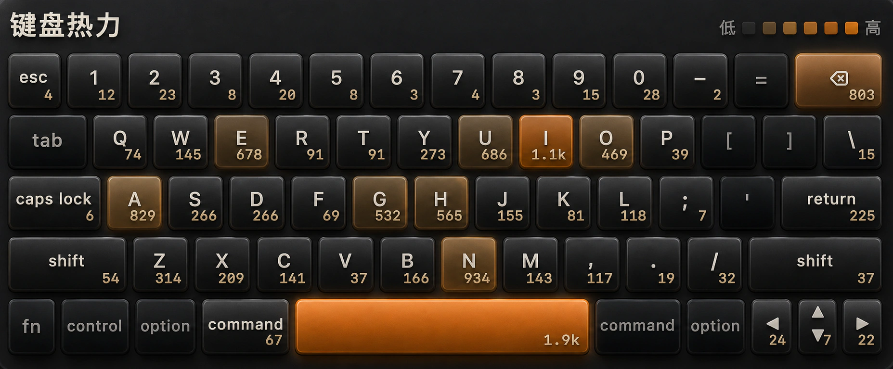
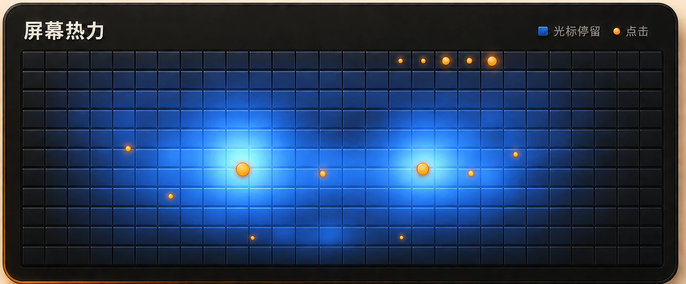

# 敲一敲（Keydance）

敲一敲是 macOS 13 或更新版本的菜单栏键鼠统计工具。它统计每天的按键次数、鼠标点击和光标移动，不保存输入文字。常规统计默认保存在本机。

[访问官网](https://keydance.app/) · [在 Mac App Store 查看](https://apps.apple.com/cn/app/%E6%95%B2%E4%B8%80%E6%95%B2/id6797265723?mt=12) · [支持](https://keydance.app/support) · [隐私政策](https://keydance.app/privacy)

## 敲一敲是什么

敲一敲（Keydance）是一款 macOS 本地输入活动仪表，常驻菜单栏，帮助你回看今天或历史日期中的键盘、点击和光标活动。

它记录的是经过聚合的活动事实，不是你输入的内容。键盘动作不等于字数、产出或效率；光标移动是基于屏幕参数的投影距离估算。

## 怎么开始统计

1. 从 Mac App Store 下载并打开敲一敲。
2. 前往「系统设置 → 隐私与安全性 → 输入监控」，授权敲一敲。
3. 点击菜单栏中的敲一敲图标，查看当天的键盘动作、鼠标点击和光标移动。

## 核心能力

- 键盘热力图：用可视化方式回看不同按键的活动分布。
- 今日节奏：按最近 24 小时的活动节奏回看高低起伏。
- 屏幕热力：区分光标停留与点击位置，观察屏幕上的活动分布。
- 今日与历史：在同一天事实的基础上查看摘要、统计和趋势。
- 可选 Agent 聚合：在你主动连接支持的 Agent 后，查看日级编辑事实；不读取或保存原始会话。

## Input Monitoring 与隐私

为了观察系统范围的输入活动，Keydance 使用 macOS 的 Input Monitoring 权限和只读的 `CGEventTap`。它不会拦截或修改键盘输入，也不使用跨 App Accessibility 来读取其他应用内容。

核心记录、历史和统计默认保存在你的 Mac 上。Keydance 不保存或上传：

- 正文、剪贴板内容或截图；
- 应用、窗口、URL 或文件路径；
- raw keyCode 顺序、逐事件时间／顺序或原始坐标轨迹；
- Agent 原始会话、账号、密码或密钥。

Secure Input 出现时，键盘、点击和光标聚合会暂停。全球排行榜是独立的自愿参加功能：只有在你明确同意参加后，才上传最小的日级聚合；不参加排行榜不会影响本机核心记录。

## 适合谁

- 想把键盘与鼠标活动看得更直观的人；
- 想回看输入节奏、按键分布和历史变化的人；
- 关注本机保存和输入隐私边界的 Mac 用户；
- 使用 AI Coding 工具，并希望只查看日级编辑聚合的人。

## 获取 Keydance

- [官网](https://keydance.app/)
- [如何在 Mac 上统计按键次数和鼠标点击](https://keydance.app/mac-keyboard-mouse-counter.html)
- [敲一敲和 WhatPulse 的区别](https://keydance.app/whatpulse/)
- [如何查看 Claude Code 和 Codex 的本地编辑统计](https://keydance.app/ai-coding/)
- [Mac App Store](https://apps.apple.com/cn/app/%E6%95%B2%E4%B8%80%E6%95%B2/id6797265723?mt=12)
- [隐私政策](https://keydance.app/privacy)
- [支持与帮助](https://keydance.app/support)
- [全球排行榜](https://keydance.app/ranking/)

## 常见问题

### Keydance 会记录我输入的文字吗？

不会。Keydance 只保留用于统计的聚合数据，不保存正文、剪贴板、截图、应用或窗口内容。

### 为什么需要 Input Monitoring？

它用于观察系统范围的键盘、点击和光标活动。Keydance 使用只读事件观察，不拦截或修改输入；你可以在 macOS 系统设置中管理权限。

### Keydance 会自动把数据上传到云端吗？

本机核心记录默认留在 Mac 上。排行榜是独立的 opt-in 功能，只有你明确参加后才会上传固定的 13 字段日级输入汇总。

### 7 天后还能免费统计吗？会自动扣费吗？

新用户首次使用有一次本机 7 天完整体验，无需购买，到期不会自动扣费。到期后，本机继续统计；今天的键盘、点击、光标摘要和累计总数仍可免费查看。热力图、按日期回看和深入统计等功能由 Pro 解锁。Pro 有年付和一次买断，实际价格以所在地区的 Mac App Store 为准。

### 这是开源项目吗？

不是。本仓库是 Keydance（敲一敲）的官方产品介绍与公开链接页面，不是应用源码镜像；应用源码未在此仓库发布，本仓库不授予代码的开源使用许可。

错别字、失效链接或文档反馈可以发送至 [support@keydance.app](mailto:support@keydance.app)。本仓库不接受代码贡献。

---

## English

### What is Keydance?

Keydance is a menu bar app for macOS 13 or later that counts daily keystrokes, mouse clicks, and pointer movement. Core statistics stay on your Mac by default, and the app does not save typed text. You can review heatmaps and daily activity, plus local editing totals from supported agents you choose to connect.

It measures aggregated activity, not what you type. Keyboard actions are not presented as word count, productivity, or value, and cursor movement is an estimated screen-projected distance.

### Get started

1. Install and open Keydance from the Mac App Store.
2. In System Settings → Privacy & Security → Input Monitoring, allow Keydance.
3. Open Keydance from the menu bar to see today’s keyboard actions, mouse clicks, and pointer movement.

### Core features

- Keyboard heatmap for visual key-activity distribution.
- A recent-24-hour rhythm view for activity patterns.
- Screen heatmap separating cursor dwell from click locations.
- Today and historical views based on the same local-day facts.
- Optional daily Agent editing aggregates after you explicitly connect a supported Agent.

### Input Monitoring and privacy

Keydance uses macOS Input Monitoring and a read-only `CGEventTap` to observe system-wide input activity. It does not intercept or modify keyboard input, and it does not use cross-app Accessibility to read application content.

Core records, history, and statistics stay on your Mac by default. Keydance does not store or upload typed text, clipboard contents, screenshots, app or window details, URLs, file paths, raw key event sequences, raw cursor trails, Agent transcripts, accounts, passwords, or keys.

When Secure Input is active, keyboard, click, and cursor aggregation pauses. The global leaderboard is optional. If you join, it receives a fixed 13-field daily input aggregate. Local tracking continues regardless of whether you join.

### Get Keydance

- [Website](https://keydance.app/en/)
- [How to count keystrokes and mouse clicks on Mac](https://keydance.app/en/mac-keyboard-mouse-counter.html)
- [Keydance vs WhatPulse](https://keydance.app/en/whatpulse/)
- [How to view local Claude Code and Codex editing statistics](https://keydance.app/en/ai-coding/)
- [Mac App Store](https://apps.apple.com/cn/app/%E6%95%B2%E4%B8%80%E6%95%B2/id6797265723?mt=12)
- [Privacy policy](https://keydance.app/en/privacy.html)
- [Support](https://keydance.app/en/support.html)
- [Global leaderboard](https://keydance.app/en/ranking/)

### What stays free after seven days? Will I be charged?

New users get seven days of full access on first use, with no purchase required and no automatic charge at the end. Keydance keeps counting locally afterward, and today’s key, click, and pointer summaries and all-time totals remain free to view. Pro unlocks heatmaps, past-day views, and more detailed statistics. Pro is available as a yearly subscription or one-time purchase. See the Mac App Store for local pricing.

### Is Keydance open source?

No. This is the official Keydance product-information repository, not a source-code mirror. The application source code is not published here, and this repository does not grant an open-source license for the application code.

For typo, broken-link, or documentation feedback, contact [support@keydance.app](mailto:support@keydance.app). Code contributions are not accepted here.

© 2026 董娜 · Keydance
